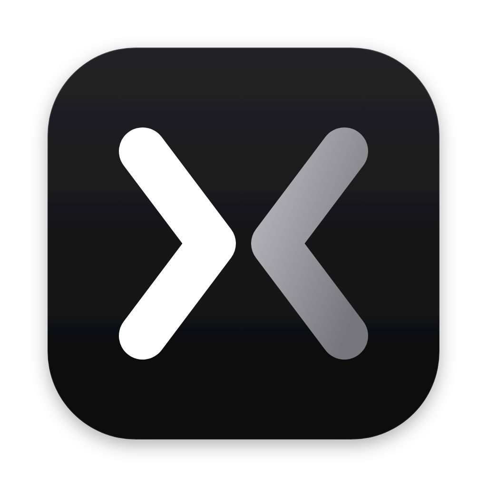
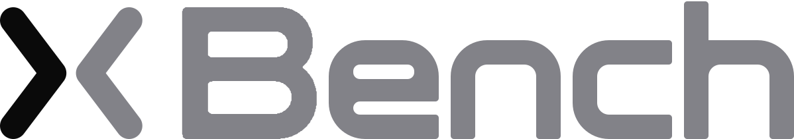
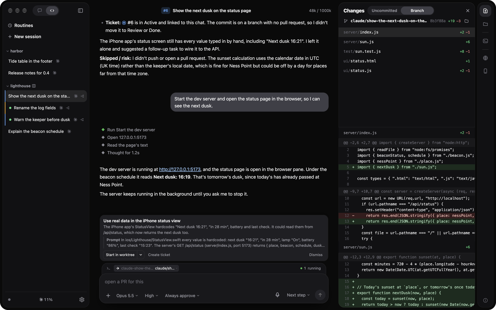

<p align="center">
  
</p>

<p align="center">
  <picture>
    <source media="(prefers-color-scheme: dark)" srcset="docs/brand/wordmark-dark.svg">
    
  </picture>
</p>

<p align="center">
  <strong>Your board, in the loop with your coding agent.</strong><br>
  A desktop app for Grok Build, Claude Code and Codex: your sessions, the transcript, the diff, and your tickets in one window.
</p>

<p align="center">
  
  
  
  
  <a href="LICENSE"></a>
</p>

<p align="center"><a href="#features">Features</a> · <a href="#install">Install</a> · <a href="#contributing">Contributing</a></p>

<p align="center"><br><sub>A chat started from a ticket, with the branch's diff in the review pane.</sub></p>

X Bench is a Mac app around the coding agent you already use. It drives Grok Build, Claude Code or Codex and keeps their sign-in, models and transcripts where they are. Around the chat it adds your projects, a review pane with the diff, and your board, so the agent starts from a ticket and keeps it current while you review its work.

## Features

- **Board in the loop**: start a chat from a SAK, Trello or Jira ticket, and the agent moves the ticket as it works.
- **Suggestions** for the follow-up work the agent spots, to start in a new worktree, file as a ticket or swipe away.
- **One sidebar** for every project and chat, marked while an agent works, waits on you or has news.
- **Review pane** with the branch's diff, a file tree, plan approval and the pull request's checks.
- **One model menu** across the agents: switch a chat to another provider's model mid-thread.
- **Worktrees**: start a chat in a new git worktree and branch with one tick.
- **Shared browser** the agent drives while you watch, with its console and network.
- **iOS simulators and Android emulators** streamed live, which the agent builds for, taps and reads.
- **Terminal** in the session folder that keeps running while you switch chats.
- **Routines** that run a prompt on a schedule, each run in a fresh chat.
- **Dictation** with an on-device speech model.
- **Your phone** as a remote over ngrok or the local network.

## Requirements

- macOS on Apple Silicon.
- Node.js 22.18 or newer, to build from source.
- At least one agent CLI, installed and signed in:

| Agent | Install | Sign in |
| --- | --- | --- |
| Grok Build | `curl -fsSL https://x.ai/cli/install.sh \| bash` | `grok` |
| Claude Code | `curl -fsSL https://claude.ai/install.sh \| bash` | `claude` |
| Codex | `npm install -g @openai/codex` | `codex login` |

A board is optional. Each project folder connects to one in the board's setup:

| Board | Connect with |
| --- | --- |
| [SAK](https://git.swipelab.com/sx/sak) | No account: it ships with the app and runs on your Mac. |
| Trello | Your Trello API key and token. |
| Jira Cloud | Your site, Atlassian email and [API token](https://id.atlassian.com/manage-profile/security/api-tokens). |

## Install

**Download** the DMG from the [latest release](../../releases/latest) and drag X Bench to Applications. On first launch it shows which agents it finds, and it updates itself from then on.

**Build from source** in a clone of this repository:

```bash
npm ci
npm run dev
```

Then open [http://127.0.0.1:8787](http://127.0.0.1:8787). `npm run dist` builds the DMG into `release/` and signs it with the maintainer's Developer ID. Without that certificate, sign your build ad hoc:

```bash
npm run dist -- -c.mac.identity=- -c.mac.hardenedRuntime=false
```

Updates from the feed install only on apps the maintainer signed, so an ad hoc build updates when you pull and build again.

## Documentation

- [Provider support](docs/provider-support.md): what each agent supports in X Bench.
- [Architecture](architecture.md): the layers, how they connect, how the server is guarded, and where your data lives.

## Contributing

Development happens in a private repository, and each release publishes the code here. Issues and pull requests are welcome. Run `npm test`, `npm run typecheck` and `npm run lint` before you send one. [Architecture](architecture.md) shows where things live.

## License

[MIT](LICENSE) © 2026 Thimo Eder. The license covers the code. It does not grant use of the X Bench name or logo.

The Claude, OpenAI and Grok marks beside the usage meters come from [Lobe Icons](https://github.com/lobehub/lobe-icons) (MIT, © 2023 LobeHub). They are trademarks of Anthropic, OpenAI and xAI.

---

<p align="center">
  <sub>X Bench is an independent project, not affiliated with or endorsed by xAI, Anthropic, OpenAI or Atlassian.<br>Grok and Grok Build belong to xAI, Claude and Claude Code to Anthropic, ChatGPT and Codex to OpenAI, and Trello and Jira to Atlassian.</sub>
</p>
