# Architecture

X Bench is a local window over the coding agents installed on the Mac: Grok, Claude Code and Codex. Each agent keeps its own loop, tools, login and transcripts. X Bench starts the agent, speaks the [Agent Client Protocol](https://agentclientprotocol.com) (ACP) with it, and draws the session that comes back. Around the chat it adds what a builder works with: git review, a terminal, a shared browser, iOS and Android devices, a Unity Game view, project boards, voice input and access from a phone.

## The big picture

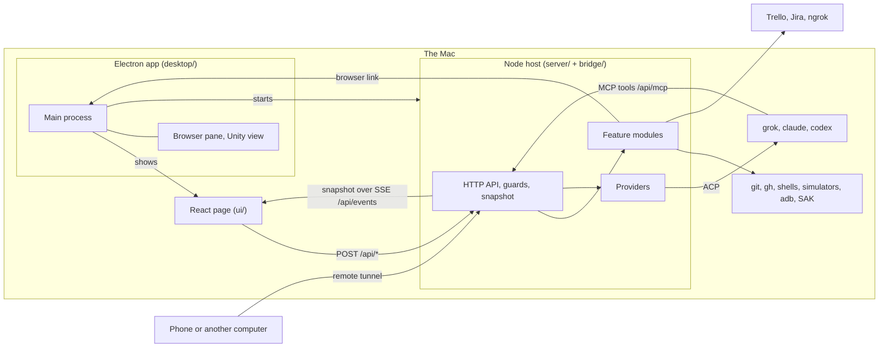

Three ideas carry the whole app:

1. **One snapshot.** The host holds one `Snapshot` object with everything the page draws. The page renders it and posts commands back. The page holds no server state of its own.
2. **One session shape.** Every agent is wrapped by a provider that turns its harness into the same `SessionState`. The page knows nothing about Grok, Claude or Codex protocols.
3. **Features run in the host.** Git, files, terminals, boards, devices and voice run in the Node host and start no agent. Agents reach them through the host's MCP server.

### Ways to run it

| Command | Port | What runs |
| --- | --- | --- |
| `npm run dev` | 8787 | The host with Vite hot reload, opened in a browser tab. |
| The installed app | 8797 | The Electron app with the bundled host and the built page. |
| `npm run app`, `npm run app:dev` | first free from 8798 | X Bench Dev from a checkout, one window and profile per checkout. |

## Layers

| Layer | Folder | Job |
| --- | --- | --- |
| UI | `ui/` | Render the snapshot, post commands, keep layout in `localStorage`. |
| Host | `server/` | HTTP API and guards, the snapshot, the desk and sidebar, and every feature that runs on the Mac. |
| Bridge | `bridge/` | The provider contract, the shared ACP client, the session reducer, one folder per provider. |
| Desktop | `desktop/` | The Electron app: window, browser pane, Unity view, native device helpers, packaging. |

Each layer has one folder per feature (`server/board/`, `ui/board/`, `desktop/devices/`). The top level of a layer holds only what every feature shares: startup, routing, the snapshot, `App.tsx`, styles and helpers.

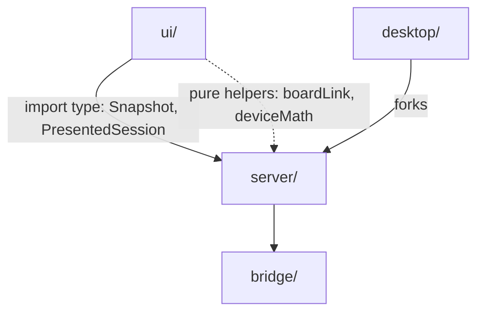

The page imports host types with `import type`, plus a few pure helpers such as `server/board/boardLink.ts`, `server/board/boardSettings.ts` and `server/devices/deviceMath.ts`. No Node code and no Zod reach the page bundle.

## A chat, end to end

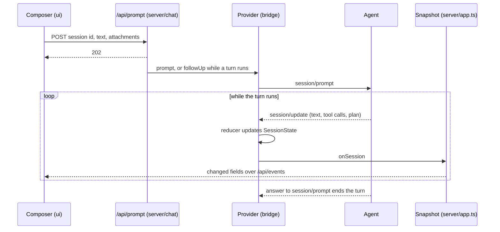

Permissions, plans and questions run the loop backwards: the agent sends `session/request_permission` or `elicitation/create`, the reducer stores it, the page draws a card, the person answers with `/api/permission`, `/api/plan` or `/api/question`, and the provider answers the waiting JSON-RPC request.

The client offers form elicitations, so Claude's `AskUserQuestion`, Codex's `request_user_input` and MCP servers' questions arrive as `elicitation/create`. `bridge/elicitation.ts` reads the form's JSON schema into fields for the question card, and the answer goes back with only the form's own fields. Grok asks with its own `_x.ai/ask_user_question`, which `bridge/grok/questions.ts` turns into the same fields. Stopping the turn answers a waiting question as cancelled.

A message sent during a turn follows the composer's follow-up choice: **Queue** holds it until the turn ends, **Next step** and **Steer** post `/api/steer` to slip it into the running turn. Providers without a native queue hold queued messages in `AcpClient`.

### Providers

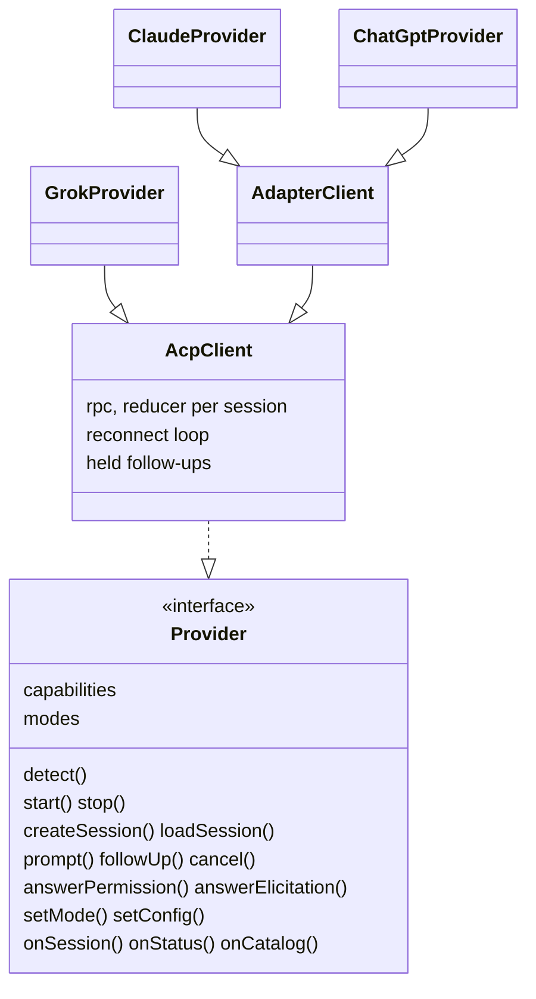

`bridge/provider.ts` is the contract between the host and one harness. Optional methods, such as `steer`, `sideQuestion`, `answerPlan` and `accountUsage`, exist when the harness has the feature. Grok keeps its own record of each session on disk, so it alone has `previewStoredSession`, `showStoredSession`, `moveSession`, `openTurns` and `followTurn`, and the host calls them where a provider has them. `capabilities` holds what the methods do not tell: reopening stored sessions, steering, steering at the next step and steering with attachments. The page's provider row adds `btw`, derived from `sideQuestion`. What each provider supports is in [docs/provider-support.md](docs/provider-support.md).

| Provider | Process | Transport | Login |
| --- | --- | --- | --- |
| Grok | `grok agent serve`, detached | ACP over a WebSocket with a per-start secret | `~/.grok` |
| Claude | `@agentclientprotocol/claude-agent-acp`, pinned and patched, running Claude Code | ACP over stdio | Claude Code's config folder, optionally chosen in `~/.x-bench/claude.json` |
| ChatGPT | `@agentclientprotocol/codex-acp`, pinned and patched, running `codex app-server` | ACP over stdio | `~/.codex` |

The app never reads or stores a harness's tokens.

Under `npm run dev` the host spawns each adapter as the leader of its own process group, which also holds the Claude Code processes it runs and their stdio MCP servers. The group gets SIGTERM when the adapter exits for any reason, so a server that ignores the end of its stdin stops too (`bridge/stdio.ts`). Inside the app, the main process stops each adapter's process tree instead (see Desktop app).

| Module | Role |
| --- | --- |
| `bridge/acp.ts` | `AcpClient`: standard ACP methods, one reducer per session, the reconnect loop, held follow-ups. Providers extend it through protected hooks. |
| `bridge/adapter.ts` | `AdapterClient`: what the Claude and Codex adapters on stdio share, such as sign-in state, notices and harness-started turns. |
| `bridge/reducer.ts` | Pure `SessionState`: transcript, permissions, questions, plan, queue, mode, tools, background tasks, suggestion, usage, last error. |
| `bridge/protocol.ts` | Standard `session/update` kinds to reducer events. |
| `bridge/tools.ts` | What a tool call does, in neutral facts: `role` (edit, shell, read, search, web, list, subagent, other), `path`, `command`, `query`, `label`, `background`, a subagent's type and an MCP tool's arguments. Each provider's `tools.ts` reads its harness's tool names and inputs into them, and the reducer runs that classifier on every tool call and permission. The page reads only the facts. `rawInput` is for the detail view. |
| `bridge/elicitation.ts` | An agent's form (`elicitation/create`) to the fields the question card draws, and the answer back to the form's own fields. |
| `bridge/rpc.ts`, `bridge/stdio.ts` | One JSON-RPC peer, and an agent on stdin and stdout. |
| `bridge/grok/`, `bridge/claude/`, `bridge/chatgpt/` | One provider each: process, extensions, models, usage reads, tool facts. Grok's also reads and writes its files under `~/.grok`: session folders, update logs and the roster of open sessions. |
| `bridge/attachments.ts`, `usage.ts` | A prompt's text and attachments as ACP content, and a harness's usage windows as the meter's shape. |
| `bridge/command.ts`, `home.ts`, `jpeg.ts`, `lenient.ts`, `fileLock.ts` | Finding programs on `PATH`, `~` paths, JPEG thumbnails through `sips`, lenient Zod helpers, lock files. |
| `bridge/testing/` | Fake agents the contract suite runs every provider against. |

Modes and config keys have neutral names, mapped inside each provider:

| App name | Grok | Claude | ChatGPT (Codex) |
| --- | --- | --- | --- |
| `ask` | (not offered) | `default` | `read-only` |
| `acceptEdits` | `acceptEdits` | `acceptEdits` | `workspace-write` |
| `plan` | `plan` | `plan` | config `collaboration_mode` = `plan` |
| `auto` | (not offered) | `auto` | `agent` (Auto review) |
| `full` (Always approve) | `agent` | `bypassPermissions` | `agent-full-access` |
| config `model` | `model` | `model` | `model` |
| config `effort` | `reasoning_effort` | `effort` | `reasoning_effort` |

### Provider lifecycle

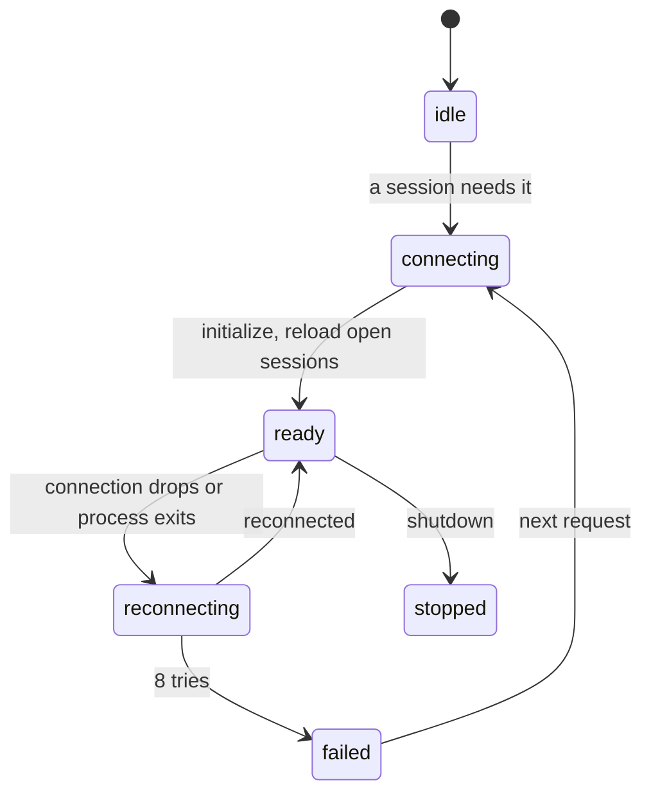

Grok starts when a page connects to `/api/events`, since its start fetches plan usage and service notices. The others start when a session of theirs opens, or on `/api/warm` while a draft is typed. A provider turned off in Settings never starts. On reconnect the client reloads every open session, and a turn that was running ends with an error.

### Picking and switching providers

`server/providers/providers.ts` is the registry. `forSession(id)` finds the provider holding a session, else the one `~/.x-bench/sessions.json` remembers, else the one whose catalog lists it, else the default provider. The providers' order (Claude, Grok, ChatGPT) picks the default until Settings chooses one. A page that opens starts each provider marked `startsWithPage` (Grok, whose usage and notices need a running agent) once `detect()` has found it installed, and never one that is off. It also reads `~/.x-bench/providers.json` from the settings page and the first-launch onboarding (`ui/onboarding/`): which providers are on, the default provider and each default mode.

A chat can move to another provider's model mid-conversation:

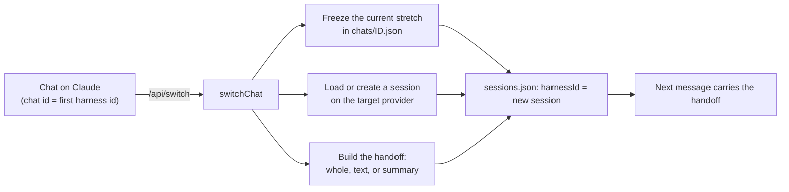

The chat keeps its first session's id. `chatView` (`server/chat/chatIds.ts`) wraps each provider and translates between that chat id and the harness session the chat runs on now, in both directions. The page shows earlier stretches above a wrinkled line where the model changed.

### Usage and errors

Plan usage per provider is read without a prompt: Grok through `_x.ai/billing`, ChatGPT through a temporary Codex app-server, Claude through the Agent SDK's `get_usage`. The host reads when a page connects, every five minutes, after each turn and after a meter's window resets. The last meters are saved to `~/.x-bench/usage.json`, so the next start opens with them.

A turn's failure lives in the session state and shows above that chat's composer. Failures of asynchronous prompts, steering and switches are kept by chat in the host. A provider startup failure shows in the window banner.

## The host

`server/index.ts` builds everything once (paths, stores, providers, desk, SAK, remote access, terminals, browser link, devices, voice, the MCP tools) and passes it to `createApp` in `server/app.ts`. Importing `app.ts` starts no server, so tests drive it directly.

### A request's path

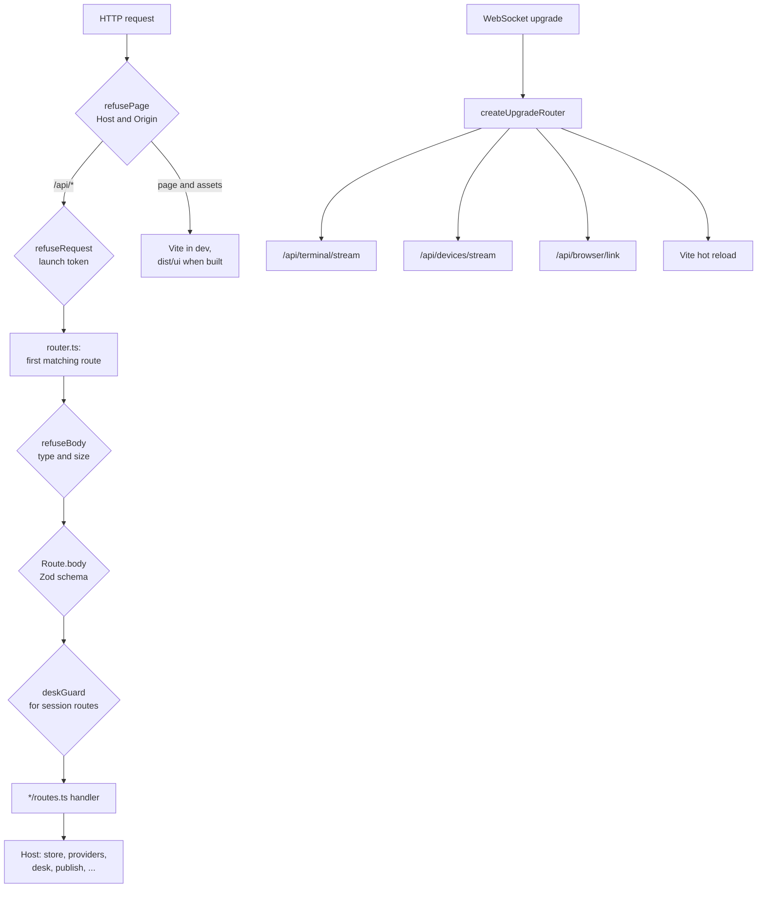

The guard matters because agents run with broad permissions on the same machine. Every `/api` request and stream upgrade must pass:

| Check | Refusal |
| --- | --- |
| Host is `127.0.0.1:<port>` or `localhost:<port>`. | `403 Unknown host` |
| Origin, when sent, is `http://<Host>`. | `403 Foreign origin` |
| The launch token is in `X-Bench-Token`, or `?token=` on a GET and the streams. | `403 Missing or wrong launch token` |
| Writes send `application/json`, or the type the route names. | `415 Send application/json` |
| The body is at most 1 MB, or the route's `maxBody`. | `413 Request body is too large` |
| The body is JSON. | `400 Request body is not JSON` |
| The JSON body passes the route's schema. | `400 <field>: <first issue>` |

The launch token (`server/launchToken.ts`) is new on every start. The host writes it into the page as `<meta name="x-bench-token">` and to `~/.x-bench/launch-token-<port>` (mode 0600), where scripts and agents read it:

```bash
curl -s -H "X-Bench-Token: $(cat ~/.x-bench/launch-token-8787)" http://127.0.0.1:8787/api/board/tasks/100
```

The page itself goes out with a Content-Security-Policy (`pagePolicy` in `server/staticUi.ts`), built and in dev. Scripts run only from the host's own files, plus the inline scripts of `index.html`, each allowed by its hash. The page connects only to its own host, and no other site may frame it. Agent, file and ticket text that slips past the Markdown, Mermaid and KaTeX sanitizers therefore cannot run script, read the token or call the API. In the window and the browser pane, links open only `http(s)` addresses (`route` in `desktop/host.js`, `paneUrl` in `desktop/browser/browserRules.js`), and the browser pane never opens the host's own page.

Board tokens and the ngrok authtoken are stored sealed (`server/secrets/secrets.ts`): AES-256-GCM under a key in `~/.x-bench/secret-key`, which the desktop main process wraps with Electron `safeStorage` (`desktop/secrets/secretKey.js`). Main sends the key to the host as its first `parentPort` message, and the host waits for it, then seals any plaintext secrets left in those files. `npm run dev` and X Bench Dev get no key: they keep their own secret files in `~/.x-bench/dev/` (`server/paths.ts`), in plaintext. When the installed app gets no key from the Keychain, it reads sealed secrets as signed out and refuses to save new ones.

Each route that reads a JSON body names a Zod schema in `Route.body`, and `route()` in `server/router.ts` types the handler's `body` from it. The schemas several groups share, such as `SessionId` and `Cwd`, live in `server/bodies.ts`. The MCP endpoint, recordings and ticket file uploads are `raw` routes that read their own bodies.

A route that acts on a session goes through `server/routeGuard.ts`: the session must be on the desk (or be a new chat's first message), and review routes refuse a chat whose folder is gone.

| Routes | Module |
| --- | --- |
| Event stream, sessions, new session, load, preview, leave, delete, relocate, surface, prompt, steer, queue, `/btw`, plan, permission, question, cancel, stopping a background task, mode, config, warm, mentions, skills, switching providers | `chat/routes.ts` |
| Sidebar: order, collapse, rename, pin, folders of chats, archive, remove a project | `sidebar/routes.ts` |
| Git status, diffs, revert, branches, checkout, worktrees, images, videos, files, pull request | `git/routes.ts` |
| The page's folder, browsing, opening a file, a draft's branches and checkout, new worktree | `folder/routes.ts` |
| Boards: `/api/board` (alias `/api/sak`), `/api/trello`, `/api/jira` | `board/routes.ts` |
| Starting or dismissing a suggested task | `board/suggestionRoutes.ts` |
| The agents' MCP endpoint `/api/mcp/<key>` | `mcp/routes.ts` |
| Browser pane controls and page thumbnails | `browser/routes.ts` |
| Terminal open and close | `terminal/routes.ts` |
| Devices, voice | `devices/routes.ts`, `voice/routes.ts` |
| Providers settings, remote access | `providers/routes.ts`, `remote/routes.ts` |
| Routines: create, change, delete, run | `routines/routes.ts`, checked in `routines/routineEdits.ts` |
| App settings: keeping the Mac awake | `settings/routes.ts` |

### The snapshot and the event stream

`createApp` owns a store with the snapshot. `publish(partial)` merges a partial into it and writes it to every `/api/events` client: the whole snapshot when a page connects, then only the top-level fields whose JSON changed (`?changes=1`). A page that accepts Brotli gets one compressor for the whole connection, so a streamed chunk costs about its own size. A running session publishes at most every 33 ms. Open sessions pass through `presentSession` (`server/present.ts`), which keeps the fields the page renders, puts each tool's facts on its row, and trims large tool inputs.

| Field | Content |
| --- | --- |
| `error` | An app or provider startup failure. |
| `providers` | Each provider's label, on or off, status, error, capabilities, modes and default mode. |
| `cwd`, `platform`, `surface` | The folder a new session starts in, the OS, the visible surface. |
| `open` | Presented sessions on the desk, each with its suggested tasks and a gone folder. |
| `projects`, `chats` | Sidebar rows: projects with their chats, and the chat surface's list. |
| `sessions` | Recent sessions in the current folder. |
| `working`, `attention`, `unread` | Sidebar marks. |
| `tickets` | Folders bound to a board, and the tickets linked to each session. |
| `usage`, `notices`, `composer` | Usage meters, service notices, every provider's models. |
| `terminals` | Each session's shells: name, whether a command runs, exit code. |
| `browser`, `deviceFocus` | The browser pane's tabs, and the device a launched app brought up. |
| `remote` | Each remote tunnel's switch, state and address. |
| `routines` | Every routine with its next run and newest runs, and which host runs the schedule. |
| `app` | Whether to keep the Mac awake, whether the experimental plan tool is on, and whether this host runs in the app. |
| `reveal` | A session every page should open, from a click on a routine's notification. |

### Desk and surfaces

The window shows one surface at a time. `server/desk.ts` is the list of visible session ids. `server/surface.ts` parks the other surface's ids and puts them back on the next switch.

| Surface | Desk | Review dock | Sessions live in |
| --- | --- | --- | --- |
| `builder` (default) | Up to two panes. | Shown. | The project folder. |
| `chat` | One pane. | Hidden. | `~/.x-bench/chat`. |

Leaving a pane takes it off the desk; the turn keeps running and the session stays loaded. Opening a chat switches the pane at once and shows a preview (`/api/preview`) until `/api/load` finishes. Loads, new sessions and surface switches each `claim` the desk, and the last click wins: a load that a newer click overtook leaves the desk alone.

Each Claude chat holds a Claude Code process of its own, so once a second the host closes idle chats (`server/chat/idleChats.ts`): any chat unseen for two hours, and past eight loaded per provider, chats unseen for half an hour, down to eight. It keeps chats on either surface's desk, and chats that run, wait on the person, or hold queued messages or a running background task. A closed chat loads again when it is opened.

### Sidebar

Sidebar rows are the sessions in `sessions.json`, joined with Grok's session summaries and the providers' live catalogs, and arranged by `~/.x-bench/sidebar.json` (`server/sidebar/sidebar.ts`). Chats group under their project home, in folders the person or an agent makes, with worktree chats under their checkout (`server/folder/projectHome.ts`). Pinned chats lead, the rest follow by their last prompt. A new message takes an archived chat out of the archive. A once-a-second tick follows turns other Grok processes run, so they show as working and stream on screen when open (`openTurns` and `followTurn`, read from `bridge/grok/turns.ts` and `follow.ts`).

A chat whose folder no longer exists shows greyed. A removed worktree stays under its checkout (`server/folder/goneFolder.ts`). Opening it shows its transcript, refuses new prompts, review tabs and the terminal, and puts a card in the composer's place that calls `/api/relocate` to move it into a new worktree or another folder.

## The UI

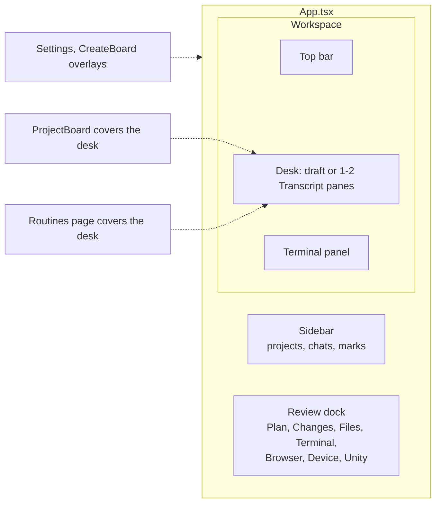

`ui/main.tsx` mounts `App`, which holds its state in one hook per job. `useSnapshot` (`ui/useSnapshot.ts`) opens one `EventSource("/api/events?changes=1")`, merges each partial into its copy of the snapshot and stores it through `shareEqual` (`ui/shareEqual.ts`), which reuses every unchanged object so memoised rows skip re-rendering. `useCall` (`ui/useCall.ts`) sends every call through `apiFetch` with the launch token (`ui/launchToken.ts`) and keeps the banner's error. `useLayout` (`ui/useLayout.ts`) holds the widths, what shows and the drags that resize them, `useDraftSession` (`ui/chat/useDraftSession.ts`) a new session from its draft until the host lists it, and `useDock` (`ui/dock/useDock.ts`) the ways into the focused chat's dock. `useDeskActions` (`ui/useDeskActions.ts`) moves between pages and chats. `App` composes the regions: `WorkspaceBar.tsx`, `sidebar/SidebarColumn.tsx`, `chat/DeskPanes.tsx`, `board/BoardPage.tsx` and `dock/DockSlot.tsx`. The panes on the desk read that call, the snapshot's notices, tickets and projects, and the desk's actions from `DeskContext` (`ui/deskContext.ts`). The page opens two WebSockets: the terminal stream and the device stream.

What covers the desk lives in one view (`ui/navigation.ts`): the desk itself, a folder's board or Routines, with Settings as an overlay. The address mirrors it, so a reload or Back lands on the same page.

A new session starts as a client-only draft. Sending it posts `/api/session`, then `/api/prompt`, after `/api/folder/worktree` when the worktree box is ticked. A draft left while it sends opens in the background. Layout, preferences and each chat's dock live in `localStorage` under `x-bench-*` keys.

Colours are variables in `ui/styles.css`, one set per theme and appearance, picked by `data-colors` (Studio or Classic) and `data-theme` (light or dark) on `<html>`. A choice stored in one window applies in the others through the `storage` event (`ui/useTheme.ts`).

| Piece | What it draws |
| --- | --- |
| `sidebar/Sidebar.tsx` | The sidebar's regions, title search, and the one menu open at a time (`sidebar/sidebarList.ts`), which closes once its row leaves the pages a project shows (`sidebar/projectRows.ts`). `ProjectSection.tsx` draws a project and its drag to reorder (`useProjectDrag.ts`), `FolderGroup.tsx` a folder of chats, and `ChatRow.tsx` a chat with its marks and menu. |
| `chat/Transcript.tsx` | One pane: header, messages, queue, composer, `/btw` window. |
| `chat/messages/MessageList.tsx` | The transcript, tool rows, page and app cards, and at its end the agent's waiting permission, question or plan as a card. Once answered, a receipt line takes the card's place; receipts live in the page (`chat/messages/receipts.ts`). |
| `chat/composer/Composer.tsx` | The message box, attachments, mentions, slash commands, voice, model and mode menus. |
| `chat/markdown/MarkdownView.tsx` | Replies, plans and Markdown files, with Mermaid and KaTeX. |
| `dock/Dock.tsx` | The review dock and its icon rail, with one pane or two (`dock/dockPanes.ts`). Each chat remembers its own dock (`dock/dockMemory.ts`), a store the page reads through `useDockPlace`. |
| `git/`, `folder/`, `terminal/`, `browser/`, `devices/`, `unity/` | The dock's tabs. |
| `board/ProjectBoard.tsx`, `board/TicketDetail.tsx` | A folder's board and an open ticket. |
| `routines/Routines.tsx`, `routines/RoutineEditor.tsx` | The Routines page and the routine editor. |
| `updater/UpdateCard.tsx` | Checking for and installing an update, from the settings gear in the sidebar's footer, and the waiting version that puts a dot on the gear. |
| `about/About.tsx` | The About window, from the info button at the rail's foot. |
| `licenses/LicensesPage.tsx` | Open Source Licenses at `/licenses`, from About. `licenses/licenses.ts` writes its list to `licenses.json` when Vite builds the page: the production packages electron-builder ships, the packages whose code ends up in the UI and host bundles, Electron, and vendored code. The dev server builds the page in memory for it. The desktop app opens it in its own window (`desktop/licenses/licensesWindow.js`). |
| `settings/Settings.tsx` | General, providers, boards, devices and remote access. |
| `phone/` | Edge-drag panels, the keyboard viewport, and the tap that closes a menu sheet on a phone. |

## Features and how they connect

Every feature hangs off a chat. The review dock shows what the chat's folder looks like; the agent reaches features through MCP tools; the board links tickets to chats.

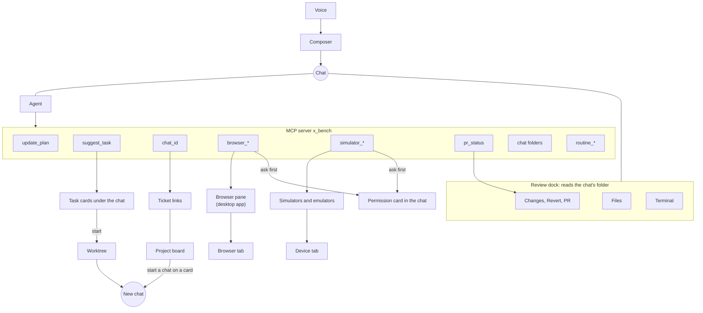

### Review dock

The dock belongs to the focused builder pane. Its work runs in the host (`server/git/localGit.ts`, `server/folder/localFiles.ts`) and starts no agent.

- **Changes** diffs the session folder against HEAD (Uncommitted) or against where the branch left main (Branch), with image and video diffs.
- **Revert** (`server/git/revert.ts`) restores the uncommitted files the tab listed, removes the new ones among them, and is refused while a turn runs or a merge is unresolved. A file changed after the list was read stays as it is.
- **Plan** shows a plan waiting for approval and the session's step list.
- **Files** is a tree of the session folder with a preview. A Markdown file switches between source and a rendered preview, here and in Changes.
- **Terminal**, **Browser**, **Device** and **Unity** are below.

The rail stays outside the dock, at the window's right edge, so it shows while the dock is closed: `App.tsx` renders its slot and the dock portals the rail into it. The slot holds About (`about/About.tsx`) at the rail's foot. In Builder the slot stays up without a chat, with the tabs greyed out. A board or the Routines page takes the rail's place. Menus hide the native Browser and Unity views wherever they overlap them. Before the Browser view steps aside, the page lays a capture of it (`browser:freeze`) in the slot, so the menu draws over a still of the page. On a phone the rail is a row of tabs on top of the full-screen dock, which shows one pane and keeps a saved split for a wider screen. A rail icon dragged onto an edge of the dock opens its surface in a second pane there. Dropped on a pane, it replaces that pane, and a pane's head dropped on the rail closes it.

The shelf over the composer shows the branch and the pull request. Its branch menu runs `git checkout <ref> --`, so a name is never read as a path, and is refused while a turn runs in the same checkout. `server/git/pullRequest.ts` runs `gh pr view`, also for a branch whose upstream has another name, and boils it down to one status (merged, conflict, failing, running, ready and others), served to the shelf through `/api/git/pr` and to the agent through `pr_status`.

### Worktrees

Sending a draft with the worktree box ticked adds a git worktree on a new branch named after the message (`server/git/worktree.ts`) in `~/.x-bench/worktrees/`, and the session starts there. Suggested tasks and board threads use the same code. A worktree without its own board binding uses its checkout's.

Deleting or archiving the only chat in such a worktree offers to remove the worktree too, with `git worktree remove`, which keeps the branch and deletes ignored files such as `.env`. Before it touches the chat, `/api/delete` or `/api/archive` reads the worktree's modified, staged and untracked files (`worktreeChanges`), and answers an error when git cannot read them. When there are any, it answers with them and changes nothing, and `ui/git/WorktreeDiscard.tsx` lists them as the Changes pane does: the person keeps the worktree, or discards the changes, which sends `discard` and removes it with `--force`.

A delete cannot be undone in the app: it removes the agent's copy of the chat (Grok's session folder, Claude's transcript; Codex moves it to its archive), its row in `sidebar.json` and its links in `tickets.json`, and the chat does not open again. Archive keeps all of it. The work survives a mistaken delete: the folder is left alone, a removed worktree comes back with `git worktree add <path> <branch>` with its commits, and the ticket stays on the board for a new chat to link.

### Terminal

`server/terminal/terminal.ts` runs one node-pty shell per tab: the login shell in the session's folder, without the host's own variables. Each shell also writes into a headless xterm that keeps its screen and scrollback, so a page that attaches gets the current screen first, then live output over `/api/terminal/stream`. Shells live in the host's memory: they keep running while the chat is off the desk and end with their tab, the chat or the host. The page draws them with xterm.js, in the dock or in a panel under the desk.

### Project boards

A folder can be bound to one board: a SAK project, a Trello board or a Jira board. The page and its messages call SAK "Local", or "the local board" in a sentence, and name SAK only in its Settings card. The code, routes, files and agent rules use `sak`. Every source implements `BoardAdapter` (`server/board/boardAdapter.ts`) and returns the same payload, with capability flags that tell the page what to leave out. Each source's folder holds its adapter and a `*Source.ts` with its binding parser and agent rules, registered by provider id in `board/sources.ts`. Its setup routes live under `/api/<provider>/`: `status`, `connection` and its board list.

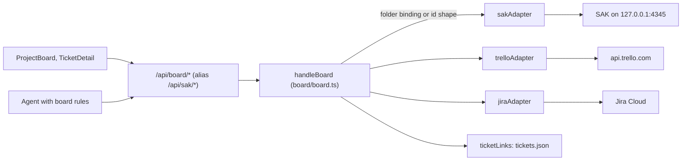

A folder route uses the folder's binding. A task route picks the adapter by the id's shape (`board/ticketId.ts`): a number is SAK's, 24 hex characters are Trello's, a key like `APP-12` is Jira's. The host starts `sak serve` itself when SAK is enabled and nothing answers (`board/sak/sakServe.ts`), with the website named in `sak.json`, or else a checkout's. A SAK without its website answers its pages with a 404, and the board then leaves out the links to them. Turning SAK on with no token first mints one into `~/.x-bench/sak.db`.

The board page draws a folder's board at once and loads it again behind it (`ui/board/useBoardLoad.ts`). It starts from the board `ui/board/boardCache.ts` kept from the last load and sends that board's activity stamp, so a source with `conditionalFetch` answers `unchanged` when nothing changed. With nothing kept since launch, it draws the host's saved copy (`/api/board/board?saved=1`), which carries no stamp, so the load after it is a full one. The host writes that copy for a board that is not local at each full load without a search, to `~/.x-bench/board-cache/` (`board/savedBoards.ts`), one file per bound folder, and removes it when the folder loses its board. A load that fails with a board on screen keeps the board, and the banner says why. The reload button in the board's bar loads the whole board without the stamp, and its tooltip tells when a load last answered. A Jira load reads the board, its configuration and its newest change in parallel, then the issue pages after the first in parallel.

Capabilities cover notes, labels, label colors, label deletes, labels without a ticket, ticket deletes, column colors, types, assignees, due dates, priority, sub-tasks, checklists, relations, comments and file embeds by name. SAK tickets relate as parent, blocks, follows, relates or duplicates; Trello and Jira refuse relations. A ticket picks its labels from the board's (`ui/board/LabelPicker.tsx`), also while it is added, and the Labels sheet (`ui/board/LabelSheet.tsx`) adds a label, onto the open ticket when it was opened from one, and deletes one. SAK sets a label's color only when it creates the label. Jira keeps a label only on its issues, so its sheet adds one only from a ticket.

Board settings sit on top of what a source sends, per bound folder, in `~/.x-bench/board-settings.json` (`board/boardSettings.ts`, kept by `board/boardSettingsFile.ts`): each column's order, hidden, collapsed and color, and the column each automatic move goes to (new ticket, work starts, pull request, merge). A move without a picked column goes to the first column with one of the names it looks for, such as In Progress or Done. The board load answers them as `settings`, `PUT` and `DELETE /api/board/settings` change them, and a change updates the rules of the folder's open chats. The page applies them in `arrangedBoard` (`ui/board/boardData.ts`) and edits them in a pane that takes the open ticket's dock (`ui/board/BoardSettings.tsx`) and from a column's header, which collapses the column into a strip. A source with `columnColors` paints its own lists, and on the others the color stays in the settings. The rules name a column only when the person picked it in the settings or its name is one a move looks for, and a ticket created without a column goes to the one picked for new tickets.

Every source reads and adds comments at `/api/board/tasks/<id>/comments`, straight from the board with nothing cached, and a ticket read carries them too. The agent rules name both routes. Every source keeps files on a ticket at `/api/board/tasks/<id>/files`, with Trello's and Jira's attachments mapped onto SAK's file shape. An upload is the file's bytes as `application/octet-stream` with `?name=`, up to 100 MiB, held in memory on its way to the source. A read passes its `Range` on, and the host serves the bytes from its own origin with `nosniff` and `Content-Security-Policy: sandbox`, so a file opened there runs no script. The ticket detail draws its description, note and comments as Markdown. An embed of a file's own url, and on a board with `embedsByName` an embed by the file's name (`!shot.png!`), loads from that route (`ui/board/ticketEmbeds.ts`). The ticket's file list tells a clip from a picture, and a clip's route ends in a video extension the route ignores, so it plays in the video player.

Boards and chats meet in five places:

- **Board rules** (`board/boardRules.ts`, each source's own in its `*Source.ts`) go into every new builder session in a bound folder and tell the agent to move tickets through this host's `/api/board/*`. When a folder gets a board, its open chats get the rules through `updateRules` in `bridge/acp.ts`: every harness keeps a session's system prompt from its start, so the rules go with the chat's next plain prompt that starts a turn (a slash command goes unchanged), inside `<x-bench-board-rules>`, which the transcript, the queue and the title leave out. They wait through closing the chat, come back when a prompt fails, and go when the folder loses its board before they are sent.
- **Links**: an agent reads its own id from the `chat_id` tool and posts `/api/board/links`. Links live in `~/.x-bench/tickets.json` and show as ticket chips in the chat and chats on the ticket. A board load also keeps each linked ticket's column color with its link, the source's own or else the one the board settings keep, so the sidebar colors a chat's bar without loading a board. A link made or a ticket changed between loads takes its color at once: from the board settings, or for a source with its own colors from the columns of the folder's last full load, which the host keeps in memory. Chips and ticket links in a chat read the colors from the board `ui/board/boardCache.ts` keeps.
- **Done tickets**: a link whose ticket moves from Review to Done gets `cleanup` in `tickets.json`. Once every ticket of the chat is done and its turn has ended, `ui/board/TicketDone.tsx` offers in the composer shelf, below the pull request row, to archive the chat with the worktree it has to itself. Archiving the chat clears `cleanup` in `/api/archive`, and the × clears it through `DELETE /api/board/links/cleanup`.
- **Board offer**: once the first turn in the first chat of a project without a board has ended, `ui/board/BoardOffer.tsx` shows a card at the end of the chat that opens Create board. Either answer hides it for that project in `localStorage`.
- **Threads**: `/api/board/threads` starts a chat for a card in the background, optionally in a worktree named after the ticket, and links it.
- **Ticket links in text**: Markdown draws a link to a board ticket (`localBoardTarget`) as `ui/board/TicketLink.tsx`. Agents write the short form `[#<id>](?task=<id>)`, which a reply resolves against its chat's folder (`chatBoardHref`). A ticket link shows a ring in the color of the ticket's column, and the ticket on hover. `ui/board/boardCache.ts` loads each folder's board once for every link to it, reads a ticket the load leaves out on its own, and loads again after a board write in the snapshot's `tickets.changes` or when the window gets focus.

Every string in a board API reply, and the board text in the board rules and a thread's brief, is stripped of hidden characters (`board/boardText.ts`). In the desktop app, a board can also open signed in on its own site in a separate browser partition (`ui/board/BoardSite.tsx`).

### Agent tools (MCP)

The host serves one MCP server, `x_bench`, over Streamable HTTP at `/api/mcp/<key>` (`server/mcp/mcp.ts`). Each `session/new` and `session/load` gets a fresh key that names its session, so every tool call knows its chat. Tool groups plug in their tools and a line for the system prompt: `update_plan` (`server/chat/planTool.ts`), task suggestions, `chat_id`, the browser, the simulators, `pr_status`, chat folders (`server/sidebar/folderTools.ts`) and routines (`server/routines/routineTools.ts`). Chats on the chat surface show no review dock, so their keys offer neither the browser nor the simulator tools, and their prompt leaves out those lines. `update_plan` is experimental: a chat gets it when `planTool` in `~/.x-bench/settings.json` is on as the chat opens (Settings › General › Experimental). It keeps the session's step list in the host (`setPlan` on the ACP client), the same state an ACP `plan` update fills, so the composer shelf and the Plan tab show it and the transcript leaves out its rows. A subagent's call changes nothing, since the plan belongs to the main agent; its tool carries `_meta["anthropic/alwaysLoad"]` so Claude Code lists it upfront instead of behind tool search. While the setting is off, Claude Code starts with its own task tools turned on.

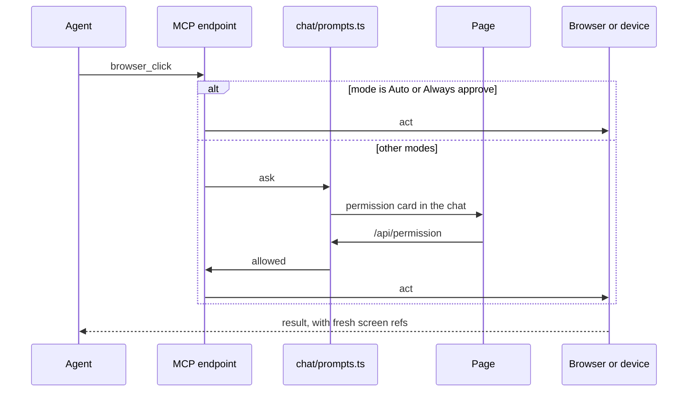

"Always allow" covers one site or one device for the session. Routine changes ask the same way, with no "Always allow", and a create or change of a routine whose runs start in Always approve asks in every mode. Stopping the turn denies a waiting card.

**Suggested tasks.** `suggest_task(title, summary, prompt)` saves a follow-up in `~/.x-bench/suggestions.json`, and `ui/board/TaskCards.tsx` stacks it under the chat. Starting a card (`server/board/taskStart.ts`) opens a new chat in the background, in a new worktree from the latest main, on a `task/<slug>` branch in the project folder, or in the folder as it is. `startChat` (`server/chat/chatStart.ts`) readies the folder, creates and names the session, and sends the prompt, for these chats and for routine runs. A card can also become a ticket, or be dismissed.

### Browser pane

The desktop app has a browser the person and the agent share. `desktop/browser/browser.js` keeps each tab as a `WebContentsView` in its own partition, so pages share no cookies with the app. Each tab belongs to one chat. The page reports where the Browser tab's slot is through the preload, and the focused chat's current tab draws there.

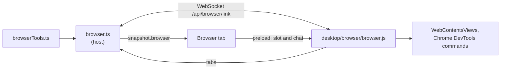

The tools navigate, read and find on the page, click, type, scroll, take screenshots, read the console and network (with secrets hidden), run JavaScript and set the viewport. A page opened in a new tab saves a thumbnail and shows as a card in the transcript. The pane's partition refuses every request to the host, because the page carries the launch token. Without the desktop app, the Browser tab opens addresses in a new window.

### Devices

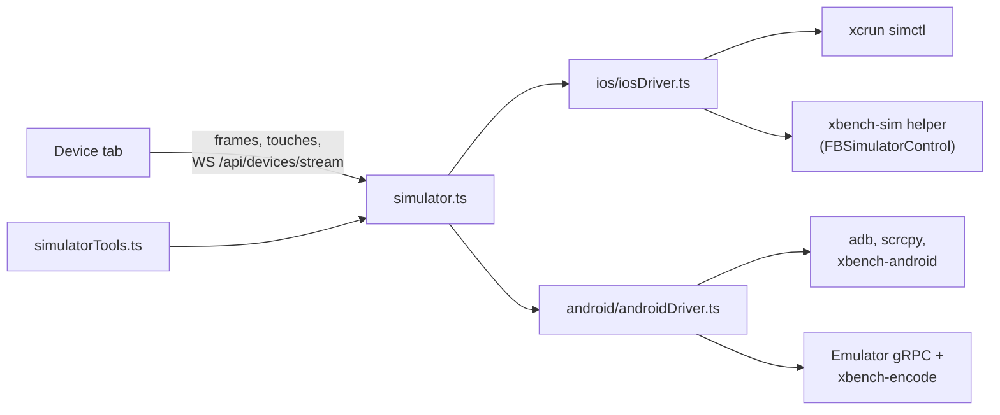

`server/devices/devices.ts` keeps the Device tab's list of running devices and the device a launch brings up. Everything else goes through `simulator.ts`, which checks that a device runs and hands it to its platform's `PlatformDriver`. Positions are in points on iOS and dp on Android, and each driver scales them to pixels. The iOS driver uses simctl and `xbench-sim` (`desktop/devices/sim-helper`), a Swift helper per booted simulator, for input, the accessibility tree and the stream. The Android driver uses adb, scrcpy's server for input and the stream (X Bench ships it in `desktop/devices/android-helper/scrcpy`), the emulator's gRPC endpoint for an emulator's stream, and `xbench-android`, a small helper pushed to the device for screenshots and the UI tree. The Device tab streams H.264 over `/api/devices/stream`, decoded with WebCodecs, fanned out to every viewer by `videoFanout.ts`, and sends touches and keys back over the same socket.

The `simulator_*` tools list and boot devices, build with xcodebuild in the background, install, launch, read the screen's tree with refs, tap, swipe, type and press. Acting tools answer with the screen's controls and fresh refs, so the agent rarely needs a screenshot. `simulator_steps` runs a whole flow in one call. A launch focuses the Device tab for that chat through `snapshot.deviceFocus`.

### Unity view

The desktop app's Unity tab shows a running Unity Editor's Game view, without the host. X Bench's Unity package (`desktop/unity/package`) publishes the Game view over Syphon and takes touches. A native addon (`desktop/unity/unity-view`) draws each frame into a Metal layer over the page, placed where the tab's slot is. The page sends clicks and keys through the preload, and the main process forwards them to the Editor's Pipeline server for the chat's project (`desktop/unity/unityView.js`).

### Voice

The composer records a WAV and posts it to `/api/transcribe`. `server/voice/voice.ts` transcribes it locally with sherpa-onnx and the Parakeet model. The model downloads only when the user agrees in `ui/voice/SpeechModel.tsx`: `POST /api/voice/download` returns at once, the page polls `GET /api/voice` for the state (missing, downloading, unpacking, loading, ready or error), and the archive unpacks into a `.partial` folder that moves into place only once its weights are complete. While a take records, `server/voice/quietVolume.ts` turns the Mac's output volume down.

### Remote access

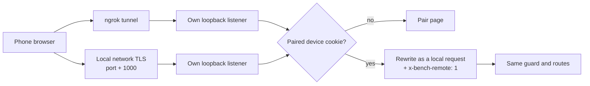

`server/remote/remote.ts` runs two tunnels that switch on independently: ngrok (`remoteTunnel.ts`) and a TLS listener on the local network (`localTunnel.ts`), whose certificate comes from a CA made once in `~/.x-bench/remote-ca`. Paired devices are hashes in `~/.x-bench/remote-devices.json`, read on every check, so a device removed in one X Bench process is refused by all. Remote pages get the built page without the launch token. The terminal, devices, browser controls, MCP, remote settings, the board's signed-in tab, and the routes that open a dialog or Finder on the Mac are refused, and so is every WebSocket. The page hides what remote pages cannot use (`remotePage` in `ui/launchToken.ts`).

### Routines

A routine is a prompt X Bench sends on a schedule, each run in a new chat off the desk: in a new worktree from the latest main on a `routine/<name>-<date>` branch, or in the folder as it is. Routines run while a host is open, and runs stay out of the sidebar.

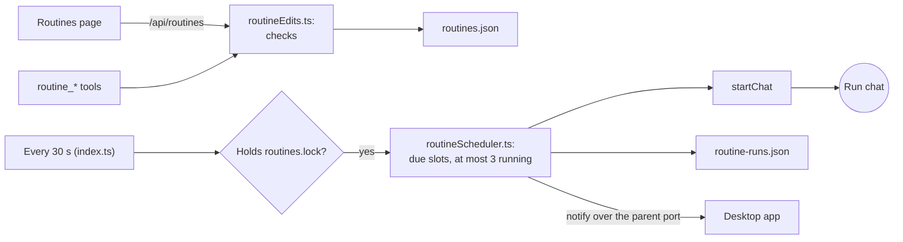

`routines/routineSchedule.ts` is the schedule math the page shares: manual, every N hours, days at a time, or once, in local time. One host at a time holds `~/.x-bench/routines.lock` (`routines/routineLock.ts`) and runs due slots. A missed slot from the last 7 days runs once as a catch-up, and a slot whose last run still works or waits is skipped. The scheduler follows each run to its end, records the outcome, notifies, and closes a finished run once it is on neither surface. Once an hour it removes the worktree of each run that ended a day ago with `git worktree remove`, which keeps the branch and refuses modified or untracked files, and skips a run whose chat works, waits or is open. The run records that its worktree went, or git's reason it stays. A gone folder or three failed starts in a row pause the routine. X Bench Dev hosts start with `X_BENCH_ROUTINES=off` unless started with `--routines`.

Keeping the Mac awake is a setting in `~/.x-bench/settings.json`. Every app host sends `keep-awake` over the parent port, and `desktop/main.js` holds a `powerSaveBlocker` while it is on.

## Desktop app

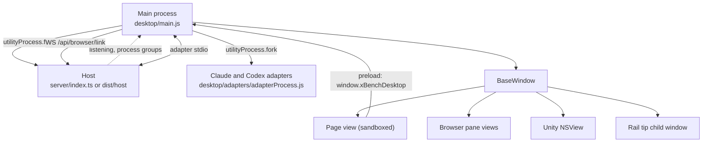

`desktop/main.js` reads the login shell's environment once, forks the host in a utility process and opens the window once the host reports `{ type: "listening", port }` (`server/parentPort.ts`). The host's own environment takes only `PATH` and the certificate settings (`NODE_EXTRA_CA_CERTS`, `SSL_CERT_FILE`, `SSL_CERT_DIR`) from it. The whole environment goes to the host in its first message, and `adapterEnvironment` (`bridge/adapter.ts`) starts the agents, their sign-in checks and the terminal from it, so they see the variables the shell profile exports, such as `CLAUDE_CODE_OAUTH_TOKEN`, API keys and proxies. It is never logged. Until then the window shows `desktop/launch.html`. Quitting sends `{ type: "stop" }`. If the host dies, the window shows `desktop/error.html` with a Restart link, and the app ends the agent and SAK process groups the host reported. The same page shows when the page's renderer is gone or the host's page fails to load, and there Restart loads the page again. With `X_BENCH_URL` the app opens an existing host instead. Everything the main process and the host print, and the reason any helper process ended, also goes to `output.log` in `~/Library/Logs/<app name>/`, each line with its time and each start with a line naming the version, where the app runs from and the macOS version, so each X Bench Dev and packaged copy keeps its own, created with mode 0600 and moved to `output.log.old` once it passes 5 MB (`logFile` in `desktop/host.js`).

The window is transparent, and the page view is rounded to a 26pt corner (square in full screen), so the panes can be concentric with it (`--window-corner` in `ui/styles.css`). Until the page paints, the view shows the background of the stored or system appearance.

The packaged app's fuses turn off `ELECTRON_RUN_AS_NODE`, `NODE_OPTIONS` and `--inspect`, encrypt the cookie store with a Keychain key, and load only an `app.asar` whose hash matches, so no other process runs code under the app's signature and Keychain access. They also deny `file://` pages the extra privileges Electron grants them, so the launch page, the error page and the browser pane's viewport badge load from `x-bench://app/`, a scheme of the default session whose handler answers only those three files, read from the app's files (`desktop/appPages.js`). The error page's Restart link is `x-bench://app/error.html?restart`, which the main process catches as it navigates. The host therefore cannot start the Claude and Codex adapters with node itself. Inside the app it sends `adapter-start` over the parent port (`bridge/relay.ts`), and the main process forks each adapter in its own utility process (`desktop/adapters/`), relays its stdin, stdout and stderr, and stops the adapters when their host exits. Under `npm run dev` the host spawns them with node.

The page runs sandboxed with context isolation. The preload (`desktop/preload.cjs`) exposes `window.xBenchDesktop`:

| Call | Purpose |
| --- | --- |
| `appName` | X Bench Dev's `--label`, shown next to the traffic lights. |
| `browserBounds`, `browserFreeze` | Where the browser pane goes and whose tabs it shows, and a still of it while a menu covers it. |
| `railTip` | The dock rail's hover label, drawn above the native views. |
| `screenshot` | On a Mac, the composer's Take a screenshot: `screencapture -i` in the main process, read back as PNG bytes (`desktop/screenshot/`). |
| `theme` | The chosen appearance, for the next launch screen and the window's background. |
| `unityBounds`, `unityFolder`, `unityPointer`, `unityKey`, `unityFullScreen`, `onUnityStats` | The Unity view's place, project, input, fullscreen and frame stats. |
| `updateCheck`, `updateInstall`, `updateRestart`, `onUpdate` | The updater. |

From a checkout the app is X Bench Dev: `desktop/dev-app.js` copies Electron.app into `node_modules/.cache/x-bench-dev`, named after the `--label`, with its own bundle id, profile and port. With `--watch` it restarts the host when a file the host imports changes.

The app updates itself with electron-updater from `latest-mac.yml` on the feed named under `publish` in `desktop/electron-builder.json` (`desktop/updater/`). The installed app's main process reads the feed 30 seconds after launch and every six hours, without showing a failed check, and on the gear's Check for updates. Its requests send the `x-user-staging-id` header blank, so the random install ID electron-updater keeps in `.updaterId` in the profile stays on the Mac. It takes only a newer version and downloads the zip, or only the blocks that changed since the last update it downloaded, using the blockmaps of both versions on the feed. electron-updater checks the zip's SHA-512, and Squirrel.Mac installs it only when the same team's Developer ID signed it, on restart through `quitAndInstall()` or when the app quits.

`npm run dist` fetches Electron's binary, builds the page into `dist/ui` with Open Source Licenses and Chromium's credits (`chromium-licenses.html`, from Electron), bundles the host into `dist/host` and the SAK binary into `dist/sak` (from a SAK checkout next to this repo, or from `vendor/sak`; the app ships no SAK website), builds the device helpers and the Unity addon, and runs electron-builder into `release/`: a DMG, and a zip with its blockmap and `latest-mac.yml` for the updater. Native modules (node-pty, sherpa-onnx-node, @ngrok/ngrok) stay outside the bundle and are unpacked from the asar archive. The archive carries only the packages that the adapters, electron-updater and these native modules load from `node_modules`; `desktop/package.test.js` checks the exclusions in `desktop/electron-builder.json` against their import graph. A dependency change goes through patch-package in `patches/`.

## Where state lives

The harnesses own the agents and their transcripts. X Bench owns the window, the sidebar, the board links and the chat-to-provider mapping.

| State | Store | Written by |
| --- | --- | --- |
| Live session | The provider's memory, then the snapshot | The reducer |
| Grok transcripts, summaries, `/btw` history | `~/.grok/sessions/` | `grok` |
| Grok auth, models, worktree map | `~/.grok/` | `grok` |
| Which Grok sessions this host has open | `~/.grok/active_sessions.json` | The Grok provider, under a file lock |
| Claude transcripts and login | Claude Code's config folder | `claude` |
| ChatGPT transcripts and login | `~/.codex` | `codex` |
| Claude and ChatGPT `/btw` history | `~/.x-bench/btw/` | This host |
| Each session's provider, current harness session, and settings a reload drops | `~/.x-bench/sessions.json` | This host |
| A switched chat's earlier stretches and pending handoff | `~/.x-bench/chats/<id>.json` | This host |
| Sidebar order, pins, folders, archive, names | `~/.x-bench/sidebar.json` | Every host on the same home |
| Board connections, bindings, ticket links | `~/.x-bench/{sak,trello,jira,tickets}.json` | Every host on the same home |
| Board settings: columns, automatic moves | `~/.x-bench/board-settings.json` | Every host on the same home |
| Each bound folder's Trello or Jira board as last loaded | `~/.x-bench/board-cache/` | Every host on the same home |
| Suggested tasks | `~/.x-bench/suggestions.json` | Every host on the same home |
| Routines, keeping the Mac awake and experimental features | `~/.x-bench/routines.json`, `settings.json` | Every host on the same home |
| Routine runs, and which host runs the schedule | `~/.x-bench/routine-runs.json`, `routines.lock` | The host that runs the schedule or starts a run |
| Providers on, defaults; Claude's folder and binary | `~/.x-bench/providers.json`, `claude.json` | The settings page; providers.json also the first-launch onboarding |
| Model lists, last usage meters, slash commands | `~/.x-bench/{claude,chatgpt}-models.json`, `usage.json`, `harness-commands.json` | This host |
| Worktrees | `~/.x-bench/worktrees/` | This host, with git |
| Chat-surface session folder | `~/.x-bench/chat` | This host |
| Page and app thumbnails, simulator builds and logs | `~/.x-bench/browser-pages/`, `simulator-builds/`, `simulator-logs/` | The browser and simulator tools |
| Speech model | `~/.x-bench/models/` | Voice |
| Remote settings, paired devices, local CA | `~/.x-bench/remote.json`, `remote-devices.json`, `remote-ca/` | Remote access |
| Launch token | `~/.x-bench/launch-token-<port>` | This host, on each start |
| Terminal shells and screens | The host's memory | `server/terminal/terminal.ts` |
| Browser pane cookies and logins | The app's `persist:x-bench-browser` partition | The desktop app |
| Layout, preferences, each chat's dock | Browser `localStorage`, `x-bench-*` keys | The page |

Every `~/.x-bench` path comes from `xBenchPaths()` (`server/paths.ts`). Most JSON files go through `server/jsonFile.ts`, which writes atomically and keeps a `.bak` of a file that does not read. `X_BENCH_*` variables move single files for tests.

## ACP methods this app uses

Standard: `initialize`, `session/new`, `session/load`, `session/prompt`, `session/cancel`, `session/close`, `session/set_mode`, `session/set_config_option`, and the agent requests `session/request_permission` and `elicitation/create` (form mode; a URL request is declined). Claude and Codex also use `session/list` and `session/delete`.

| Provider | Extensions |
| --- | --- |
| Grok | Turn: `_x.ai/interject`, `_x.ai/queue/{edit,remove,reorder}`, `_x.ai/btw`, `_x.ai/suggestPrompt`, `_x.ai/billing`, `_x.ai/task/kill`. Requests the host answers: `_x.ai/exit_plan_mode`, `_x.ai/ask_user_question`. Notifications: `_x.ai/session/*`, `_x.ai/session_notification`, `_x.ai/queue/changed`, `_x.ai/sessions/changed`, `_x.ai/models/update`, `_x.ai/settings/update`. |
| Claude adapter | Patched: `_session/steering` (with `priority` and `uuid`), `_session/steering/cancel`, `_session/btw`. Also `_session/async_task/stop`, and the notifications `_auth/status_update`, `async_task_*`, `notice`, `session_info_update` with `_meta.promptSuggestions`, `_claude/sdkMessage` (`command_lifecycle` only) and `_claude/rateLimit` in `usage_update`. |
| Codex adapter | `_session/steering`, `_session/async_task/stop`, and the notifications `_auth/status_update`, `async_task_*`, `subagent_spawned`, `subagent_state_update`, `notice` and `_meta.codex.threadStatus` in `session_info_update`. A subagent's own session reaches the client too; `bridge/adapter.ts` shows its tool calls and requests in the parent's chat. Patched to read `_meta["x-bench/codex"]` on MCP servers for tools that run without asking. ChatGPT side questions use `session/fork` with `_meta["x-bench/sideQuestion"]`, patched to create an ephemeral Codex thread. The patch also switches off the user's Codex MCP servers and plugins on that thread. The provider asks it to answer without tools in plan mode under the read-only preset, collects its answer outside session state, then deletes the fork. |

## Types, schemas and tests

The app is TypeScript. Node 22.18+ strips types at startup, Vite serves `ui/*.tsx`, and `tsc` only checks (`strict`, `noUncheckedIndexedAccess`, `erasableSyntaxOnly`, `verbatimModuleSyntax`), so the code has no enums, namespaces or parameter properties.

| Type | Where | Used by |
| --- | --- | --- |
| `SessionState`, `ReducerEvent` | `bridge/reducer.ts` | The bridge, the presenter |
| `PresentedSession` | `server/present.ts` | The host, the page |
| `Snapshot` | `server/snapshot.ts` | The host, the page |

Data from outside the process (ACP messages, harness files, `~/.x-bench` config, board APIs) goes through Zod 4 schemas with the lenient helpers in `bridge/lenient.ts`: unknown fields pass, a field with the wrong type reads as missing, a bad list item is skipped. Schemas for data forwarded to the page keep only listed fields. A request body goes through its route's schema instead, and one that fails it gets 400.

`npm test` runs `node --test` across all layers. `bridge/providers.contract.test.ts` runs one contract suite against a fake of each provider. `server/app.test.ts` drives `createApp` over HTTP with a fake Grok, real git in scratch repositories and a scratch `HOME`. UI tests render in happy-dom (`ui/testing/dom.ts`). `npm run smoke` talks to a live `grok agent serve`. `npm run typecheck` runs `tsc` on the app and the voice worklet, and `npm run lint` runs oxlint.
